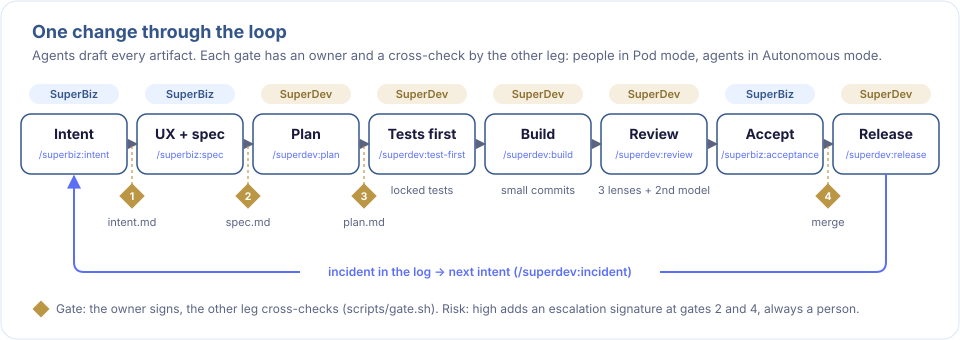
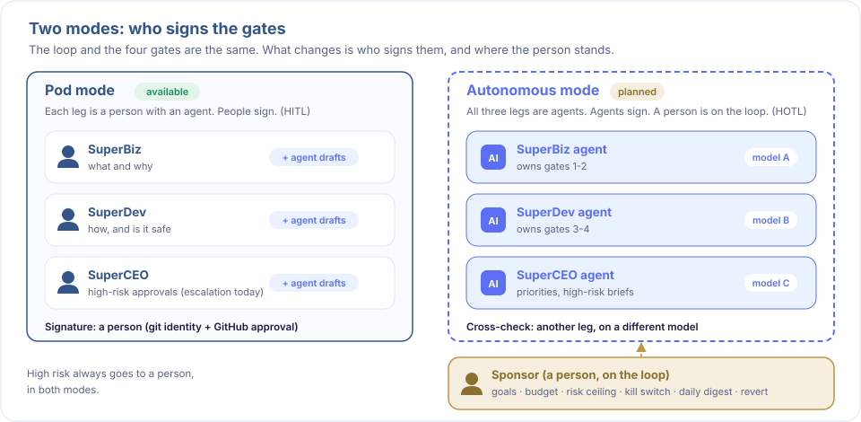

# Tripod

[](LICENSE)
[](https://github.com/feronera/tripod/releases)
[](https://claude.com/claude-code)

**An agentic delivery practice.** Three agent legs (SuperBiz, SuperDev and SuperCEO) run every change through four gates, and scripts, hooks and CI enforce the rules.

- **SuperBiz** covers product, analysis and design. It owns gates 1 and 2: what to build and why.
- **SuperDev** covers architecture, build, test, release and operations. It owns gates 3 and 4: how, and whether it is safe.
- **SuperCEO** ranks the work and briefs people on high-risk decisions. It never signs.

Each gate has an owner and a cross-check by the other leg, so the author never approves their own work. Every change lives in `docs/changes/NNN-slug/`, with its artifacts and the signatures in `gates.log`.

Tripod ships as three Claude Code plugins, gate scripts, document templates and a CI workflow, for any stack.



## Install

Requirements: Python 3.10 or later, git, make and [Claude Code](https://claude.com/claude-code). No other packages.

```bash
git clone https://github.com/feronera/tripod ~/tripod
mkdir my-pod && cd my-pod && git init
~/tripod/scripts/pod-install.sh . --with-sample   # leave out --with-sample for an empty project
# Edit pod.yml: names, emails (matching each person's git config user.email) and GitHub logins
scripts/sync-codeowners.sh
make setup && make check
git add -A && git commit -m "chore: start pod"
```

For an existing project, run `~/tripod/scripts/pod-install.sh .` in its repository. The installer detects Node, Python and Go and never overwrites `Makefile`, `AGENTS.md` or `CLAUDE.md`. The adoption guide is in [docs/adopt.md](docs/adopt.md).

Each person installs the plugin for their role:

```text
/plugin marketplace add feronera/tripod
/plugin install superbiz@tripod     # or superdev@tripod, superceo@tripod
```

To try one for a single session: `claude --plugin-dir ~/tripod/plugins/superbiz`.

Protect the main branch with `scripts/setup-github.sh <owner/repo>`. It prints the plan; add `--yes` to apply it.

## A change, end to end

| Step | Who | Command |
|---|---|---|
| 1. Start and draft the intent | SuperBiz | `scripts/new-change.sh <slug>`, then `/superbiz:intent` |
| Gate 1 | SuperBiz, then SuperDev | `scripts/gate.sh docs/changes/NNN-slug 1` |
| 2. UX brief and spec | SuperBiz | `/superbiz:ux-brief`, `/superbiz:spec` |
| Gate 2 | Both (+ escalation if high) | `scripts/gate.sh … 2` |
| 3. Plan | SuperDev | `/superdev:plan` |
| Gate 3 | Both | `scripts/gate.sh … 3` |
| 4. Tests first, then lock | SuperDev | `/superdev:test-first`, `touch .pod/lock-tests` |
| 5. Build and review | SuperDev | `/superdev:build`, `/superdev:review`, open a pull request |
| 6. Merge by risk | SuperDev | `/superdev:merge` |
| 7. Accept | SuperBiz | `/superbiz:acceptance`, then gate 4 |
| 8. Release | SuperDev, SuperBiz | `/superdev:release`, `/superbiz:release-notes` |

Check any change with `scripts/gate-check.sh <dir>`, and everything with `make check` (CI runs it on every pull request). Use `/superdev:bug-fix` for defects, `/superdev:arena` to compare two designs and `/superdev:incident` to turn a log into the next intent.

**See it in practice:** [feronera/tripod-example](https://github.com/feronera/tripod-example) has real changes on GitHub with pull requests, CI, approvals and costs.

## Two modes

The loop and the four gates are the same in both modes. What changes is who signs.



| | Pod mode | Autonomous mode (low risk) |
|---|---|---|
| Who signs | The person in each leg, at every gate | People sign gate 1; then agents on different models sign and cross-check |
| Where the person is | In every leg | One sponsor, on the loop: budget, limits, kill switch, digest |
| Medium and high risk | People; escalation signs high | Always people |
| Details | [docs/gates.md](docs/gates.md) | [docs/autonomous.md](docs/autonomous.md) |

Safety in both modes:
- Agents merge only low-risk work, and only after `scripts/auto-merge-check.sh` says `ALLOW` ([docs/merge-by-risk.md](docs/merge-by-risk.md)).
- Editing an approved artifact makes its approval stale. Touching a path in `docs/risk-paths` makes a change high risk.
- `touch .pod/kill-switch` stops every agent at once.

## Learn more

Each topic has one doc. Scripts link to these docs in their messages.

| Doc | Topic |
|---|---|
| [gates.md](docs/gates.md) | The four gates, how to sign, and review questions |
| [risk-tiers.md](docs/risk-tiers.md) | Choosing low, medium or high |
| [merge-by-risk.md](docs/merge-by-risk.md) | Who merges at each tier, auto-merge conditions, revert |
| [scaling.md](docs/scaling.md) | Pods of 3 or more, bootstrap with fewer people, tribes |
| [autonomous.md](docs/autonomous.md) | Agent seats, sponsor limits, the loop, SuperCEO |
| [activity-log.md](docs/activity-log.md) | What the agents did and what it cost |
| [test-strength.md](docs/test-strength.md) | Finding weak tests |
| [parallel-agents.md](docs/parallel-agents.md) | Several agents at once, and arena |
| [pod-charter.md](docs/pod-charter.md) | The pod's working agreement and trust ladder |
| [adopt.md](docs/adopt.md) | Installing, configuring and updating in an existing project |

## Built with Tripod

This repository is a pod: every change goes through the four gates in [docs/changes/](docs/changes/), and pull requests must pass `pod-gates`. `pod.yml` here is Tripod's own pod; new projects get [docs/templates/pod.yml](docs/templates/pod.yml) from the installer. Run `make check` before opening a pull request. Status and changes: [Releases](https://github.com/feronera/tripod/releases). Ideas: [Issues](https://github.com/feronera/tripod/issues).

## License and credits

MIT. See [LICENSE](LICENSE). Several engineering methods are adapted from [pstack](https://github.com/cursor/plugins/tree/main/pstack) by Lauren Tan (MIT License, Copyright (c) 2026 Lauren Tan); see [docs/credits.md](docs/credits.md).
