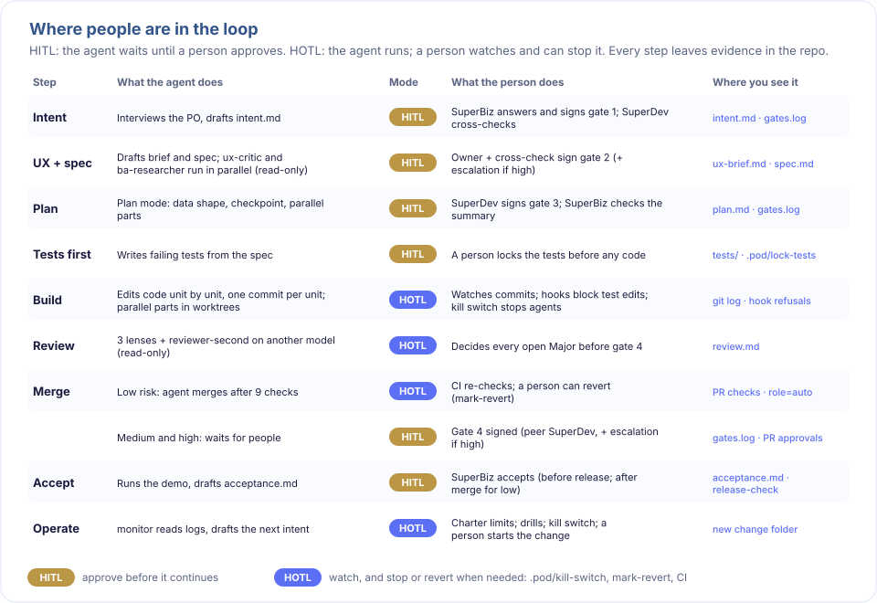

# Autonomous mode (low risk)

In Pod mode, people sign every gate. In Autonomous mode, a low-risk change needs one person, at gate 1. After that, two agent seats on different models may sign gates 2 to 4 with `scripts/agent-sign.sh`, and the change merges through the normal auto-merge checks. The loop (below) does the document part on its own: spec, gate 2, plan and gate 3; people build. A **sponsor** watches from outside the loop and can stop or revert any change. It is off by default. Medium and high risk always need people, in either mode.



## Turning it on

```yaml
mode: autonomous                      # default: pod
superbiz_agent_model: claude-sonnet-5-5
superdev_agent_model: claude-opus-5-5 # must differ from superbiz_agent_model
sponsor_name: Sam
sponsor_email: sam@example.com
sponsor_github: sam-gh
auto_merge: low                       # so a low-risk change can merge without a person
agent_sign_timeout: 600               # seconds per agent-sign run (default 600)
```

`scripts/gate-check.sh --all` (and so CI) fails when a seat model or a sponsor key is missing, or both seats use the same model. The sponsor may also hold a pod role.

## Who signs what

| Gate | Risk: low in Autonomous mode | Anything else |
|---|---|---|
| 1 (intent) | People: owner and cross. **They decide the change is low.** | People |
| 2 (spec) | `agent:superbiz` owner, `agent:superdev` cross | People |
| 3 (plan) | `agent:superdev` owner, `agent:superbiz` cross | People |
| 4 (acceptance) | Agents, after the auto-merge (post-merge acceptance) | People |

A person's signature always counts, and a gate can mix a person and an agent. Agents run `agent-sign.sh`, never `scripts/gate.sh`, which stays for people and signs as the git email.

## How an agent signs

`scripts/agent-sign.sh docs/changes/005-x 2` signs the next open seat (owner, then cross):
1. **Refuses before starting any agent** when:
   - the pod is in `mode: pod`, the change is not `Risk: low`, or the gate is 1;
   - the gate before is incomplete, the artifact is missing, or the gate is already signed;
   - `.pod/kill-switch` exists;
   - the branch touches `docs/risk-paths` (its effective risk is high);
   - the branch, committed or not, edits agent instructions or gate rules (`CLAUDE.md`, `AGENTS.md`, `.claude/`, `.mcp.json`, `docs/gates.md`, `docs/risk-paths`, `docs/model-prices`), which could steer its own checker or budget. Auto-merge refuses these files too, in either mode;
   - it is gate 4 and there is no auto-merge record yet.
2. **Runs** `claude -p --model <seat model> --output-format json --tools Read,Grep,Glob --safe-mode --strict-mcp-config`. No other tools, CLAUDE.md, hooks, plugins or MCP servers load. It gets the gate's questions from `docs/gates.md` and the artifacts. The owner seat is told it is accountable; the cross seat is told to find what the other leg missed.
3. **Approves only** when the last line is the one and only `VERDICT: APPROVE`, so quoted text cannot decide it, and Claude Code's `modelUsage` shows the seat's model ran. Anything else is REFUSE.
4. **Records.** On APPROVE it appends to gates.log; the first agent signature also records the mode and seat models:
   ```
   event=mode mode=autonomous superbiz_agent_model=claude-sonnet-5-5 superdev_agent_model=claude-opus-5-5 at=…
   gate=2 role=owner by=agent:superbiz model=claude-sonnet-5-5 session=7cc5c1d8-… at=… blob=…
   ```
   Every run, approved or refused, adds usage per model (`source=agent-sign`) and an `event=verdict` record to activity.log. A run that fails before returning JSON has no numbers to record.

## What gate-check accepts

An agent signature counts only when:
- the change was signed in Autonomous mode and is `Risk: low`;
- the gate is 2, 3 or 4, and `by=agent:<leg>` is the seat that role needs, with a `session` and a `model`;
- `model` is the seat's model in pod.yml (for a finished change in a pod that switched back, the model recorded with it on the base branch). Ids must match exactly: a dated or `[1m]` variant does not match;
- activity.log has usage for that `session` and `model`, and that session backs no other signature and did not end in REFUSE;
- at gate 4, gates.log has an auto-merge record.

Owner and cross must be on different models. In either mode, no person in pod.yml may have an email or login starting with `agent:`, and `mode` must be `pod` or `autonomous`. Staleness, signing order, "risk only goes up after gate 1" and risk-paths apply as for people.

In `mode: pod`, agent signatures count only for a finished change whose `event=mode` record is already on the base branch. A record written on a branch never turns Autonomous mode on, so a pod that switches back stops new agent signatures while its merged changes keep passing.

## The sponsor

The sponsor signs nothing, and is on the loop, not in it:
- reads each PR, including gates.log and activity.log (`scripts/activity.sh` shows `signatures: people 2, agents 6 (…)` and the cost);
- creates `.pod/kill-switch` to stop every agent at once;
- reverts a change and records it with `scripts/mark-revert.sh`, which also stops auto-merge until there is a new track record.

### Limits and automatic stops

Each limit is optional; a missing key means no limit. They apply only to agent work (`agent-sign.sh`, auto-merge and the loop), never to people's commands.

| Key | What happens |
|---|---|
| `budget_per_change_usd` | agent-sign refuses when the change's spend plus the next run would pass it |
| `budget_per_day_usd` | the same, over the last 24 hours, for the whole pod |
| `max_refusals_per_gate` | after this many refused agent checks on a gate, agent-sign refuses until a person signs a gate of the change or runs `scripts/resume.sh <dir> "<reason>"`. With `loop: on` it defaults to 3 |
| `agent_merges_per_day` | auto-merge refuses once this many changes were auto-merged in the last 24 hours |
| `agent_forbidden_paths` | agent-sign and auto-merge refuse a change that touches these globs; people can still change them at Risk: low |

- Agents pause for 24 hours after any revert.
- Spend comes from activity.log in the working tree and on the base branch, so a revert or auto-merge already on main counts on every branch.
- The next run is estimated from the most expensive agent-sign run of the last 7 days. A running session is never cut off, so a day can end slightly over budget.
- A cost that is not a finite amount of 0 or more counts as unknown. A record with no readable time counts toward its change, not toward any time window.
- `TRIPOD_NOW`, used by tests, can only move the clock back, which makes limits stricter.
- When a budget is reached, the activity hook tells the agent, once per session per limit.
- `scripts/resume.sh` records `event=resume` in gates.log with the git email, which must be the sponsor's or a member's. Resumes and people's signatures count only from them. Agents never run it.

### The daily digest

```bash
scripts/digest.sh              # the last 24 hours
scripts/digest.sh --hours 72   # a longer window
scripts/digest.sh --write      # also save docs/digest/YYYY-MM-DD.md (UTC date)
```

It lists spend (total, per change, per model, unknown), agent signatures, refused checks, auto-merges, reverts, resumes, loop runs, stops in force and the limits, from the same records the stops use. Sending it to Slack, email or an issue is left to the team.

## The loop

`scripts/loop.sh [--dry-run] [--change NNN-slug]` does one run of the document stages. Start it by hand or from cron; the kit ships no CI workflow.

```yaml
loop: on                    # default off; Autonomous mode only
loop_max_steps: 10          # steps in one run, over all changes
superceo_model: claude-opus-5-5
```

Each run gives every open change (branches named `change/NNN-slug`, in today's SuperCEO order) one step:

| State | Next step |
|---|---|
| gate 1 not complete | stop: people sign gate 1 |
| no spec.md | SuperBiz agent drafts spec.md and ux-brief.md |
| gate 2 not complete | low risk: agents sign it, after revising the spec if the last check refused it; medium or high: stop for people (SuperCEO writes a brief for high risk) |
| no plan.md | SuperDev agent drafts plan.md |
| gate 3 not complete | low risk: agents sign it, or revise the plan first; medium or high: stop for people |
| otherwise | stop: people build |

- **Isolated sessions.** `--setting-sources "" --strict-mcp-config`: no user or project settings, hooks or MCP servers, no shell and no access tokens.
- **Artifacts only.** An agent may edit only the step's artifact files. Any other change rolls the branch back.
- **Checks before every step:** the kill switch, the sponsor's limits, and that the branch changes nothing outside its own `docs/changes/NNN-slug/` folder, so the scripts, plugins and pod.yml it runs are the base branch's. Run it from the base branch, never from a change branch.
- **Records.** Each step is one commit by `Tripod loop`, recorded as `event=loop` in activity.log. `--dry-run` shows the next step of every change.
- **Never:** build, test, merge or run people's commands.

## SuperCEO

The third leg is a read-only agent in the `superceo` plugin. It advises and signs nothing.
- `scripts/superceo.sh priorities` writes `docs/superceo/YYYY-MM-DD.md`, ranking the open changes and `docs/backlog.md` with state, next step, blocker, spend and a reason.
- `scripts/superceo.sh brief <change-dir>` writes `brief.md` (Decision, Options, Risks, Evidence, Recommendation) for a medium or high change waiting at a gate. It refuses for low risk.

## Limits you accept

- **Forgery.** An agent that can edit files could write a signature line and a matching usage line by hand. Defenses:
  - the evidence has to match;
  - the low-risk limit and risk-paths (edits to scripts are high);
  - CI, and the sponsor reading the diff;
  - the kill switch and revert.

  There are no cryptographic signatures. The same holds for `TRIPOD_CLAUDE`, which tests use to replace `claude`: whoever can set it can also edit the files.
- **Agreeable reviewers.** A checking agent can approve too easily. The prompt makes it answer each gate question with evidence. Measure it on your own work, for example with a planted mistake, before you rely on it.
- **No stop on repeated CI failures.** Budgets, refusals and reverts stop agents; failing CI runs do not, yet.
- **Cost.** Every agent signature and every loop step is one `claude -p` run. Its cost lands in activity.log.
- **Agents can read what the person running them can read.** Loop and SuperCEO sessions have no shell, no settings and no secrets in their environment, but their Read tool is not limited to the repository. Run the loop as a user that holds no other secrets on disk, for example a dedicated account or container.
- **The loop writes documents with no person starting the step.** A spec or plan could still mislead later steps. The defenses are the gate checks on two models, and people starting every build.
- **Limits are checked before a run, not during it.**
  - Several agent-sign runs started at the same moment all pass the same check, so spend can overshoot by one estimate per run.
  - Branches that are not merged do not see each other's spend or merges.
  - A run that fails before it returns a verdict is not counted as a refusal.
  - The budget warning also reaches a person's own Claude Code session in the repository, because the hook cannot tell people from agents.
  - The digest shows all of this the next day.
