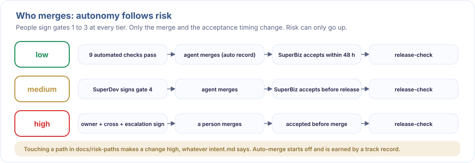

# Merge by risk

Gate 4 is split into two checks:
- **merge-ready** (`scripts/gate-check.sh <change-dir> 4`): can the change merge into main? The gate-guard hook and CI use this check.
- **release-ready** (`scripts/release-check.sh <change-dir>`): can the change be released to production? It also requires no `event=revert` record.



## Who does what at each tier

| Effective risk | merge-ready | Who merges | GitHub approval (pr-check) | release-ready |
|---|---|---|---|---|
| low | owner + cross, or a `role=auto` record | an agent, when `auto-merge-check` prints ALLOW | none when the auto record passes auto-merge-check again in CI; otherwise SuperDev | owner + cross (SuperBiz accepts within `acceptance_hours`) |
| medium | owner (SuperDev) | SuperDev, or an agent after SuperDev signs | SuperDev | owner + cross |
| high | owner + cross + escalation | a human | SuperDev, SuperBiz and escalation | owner + cross + escalation |

- Effective risk is the Risk in intent.md, except that a diff touching any path in `docs/risk-paths` is always high. A PR with no change folder follows the medium rules.
- Any member of the named role may approve, but never the PR author. If the agent opens PRs with SuperDev's account, low and medium use SuperBiz's approval instead.
- With 2 or more SuperDevs, the SuperDev approval must come from a **peer**: a SuperDev who neither opened the PR nor authored a code commit in it (one touching a file outside `docs/`). With no peer, low and medium fall back to the one-SuperDev rule (a SuperDev, or SuperBiz when a SuperDev opened the PR), and high to a SuperDev other than the author. A valid auto record still needs no human approval ([scaling.md](scaling.md#peer-review-at-gate-4)).

## The 9 auto-merge conditions (`scripts/auto-merge-check.sh <change-dir> [--base <ref>] [--record]`)

Prints `ALLOW` when every condition passes, otherwise `DENY` with one reason per line. Without `--base`, it compares with the base branch in pod.yml.

1. `pod.yml` sets `auto_merge: low`.
2. The Risk in intent.md is `low`, and the gate 1 approval is not stale (the Risk was not lowered after approval).
3. No file in `git diff --name-only <base>...HEAD` matches `docs/risk-paths`.
4. Gates 1 to 3 are complete and not stale.
5. `review.md` has `blockers: 0`, `second_opinion: agree`, and a `reviewed_head` that matches HEAD. Commits after it that only touch this change's folder do not count.
6. `test_cmd` and `scripts/test-strength.sh` pass. `strength: off` always gives DENY ([test-strength.md](test-strength.md)).
7. No lines are deleted in `tests_dir` (default `tests/`). Tests may only be added.
8. Lines changed outside `docs/` and `tests_dir` total no more than `auto_merge_max_lines`.
9. At least `auto_merge_min_track` changes have passed gate 4, and none of the most recent `auto_merge_min_track` was reverted.

It also refuses a change that edits agent instructions or gate rules (`AGENTS.md`, `CLAUDE.md`, `.claude/`, `.mcp.json`, `docs/gates.md`, `docs/risk-paths`): people merge those, so a change cannot weaken its own checks. With `--record`, ALLOW appends:

```
gate=4 role=auto by=auto-merge at=<ISO> blob=<hash of acceptance.md or -> head=<sha>
```

An agent may run `auto-merge-check.sh --record` and then `gh pr merge --auto --squash` only after ALLOW. Agents never run `scripts/gate.sh` or `scripts/mark-revert.sh`. When to turn `auto_merge: low` on is the trust ladder in [pod-charter.md](pod-charter.md#auto-merge-trust-ladder). In Autonomous mode, agents may sign gates 2 and 3 of low-risk changes, so they can merge with no person after gate 1 ([autonomous.md](autonomous.md)).

## Acceptance after merge

- After an auto record, SuperBiz may sign gate 4 (cross) before SuperDev, who then signs as owner against the same acceptance.md.
- If `acceptance_hours` passes without SuperBiz's signature, release-check says the change must not be released until SuperBiz accepts it.
- The acceptance and gate 4 signatures reach `main` in their own PR. It changes only `docs/`, so the auto record does not apply: a pod member who did not open it must approve.

## Revert

1. `git revert <commit>`, then open a PR as usual.
2. A person on the team records it: `scripts/mark-revert.sh docs/changes/NNN-slug "<reason>"`, which appends `event=revert by=<email> at=<ISO> reason="..."`.
3. release-check then fails for that change, and auto-merge stays off until `auto_merge_min_track` later changes pass without a revert.

## GitHub setup

1. Add the GitHub logins to `pod.yml` (lists in the same order as the emails), run `scripts/sync-codeowners.sh` and commit `.github/CODEOWNERS` (`make check` verifies it matches `docs/risk-paths`).
2. `scripts/setup-github.sh <owner/repo>` shows the plan; `--yes` applies it: auto-merge on, and main protected (the `pod-gates` check must pass, code-owner review required, stale reviews dismissed on new commits, force pushes blocked). Branch protection needs a public repository or a paid plan; otherwise the script stops and says so.
3. CI runs `make -f pod.mk pod-check` and `scripts/pr-check.sh`, which reads the PR author and approvers with `gh api`. GitHub approvals are tied to the signed-in account, so they are harder to fake than a git email.
