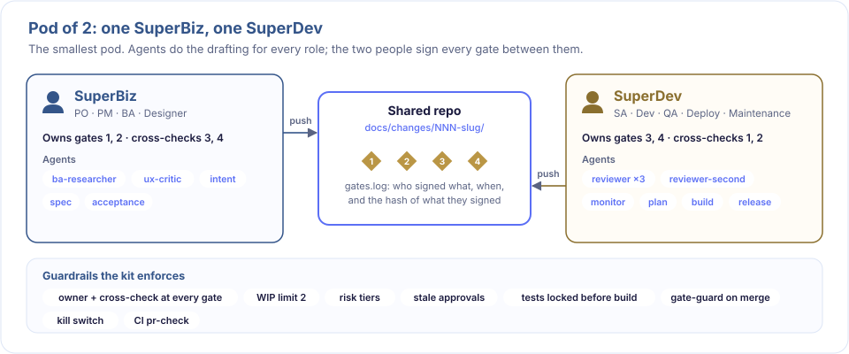
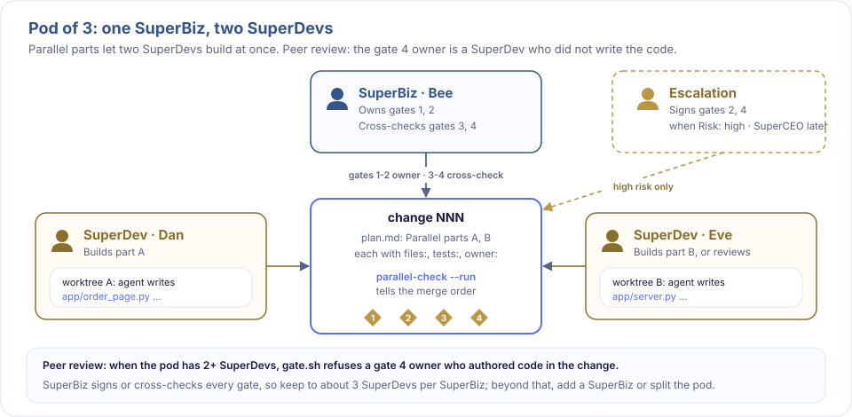
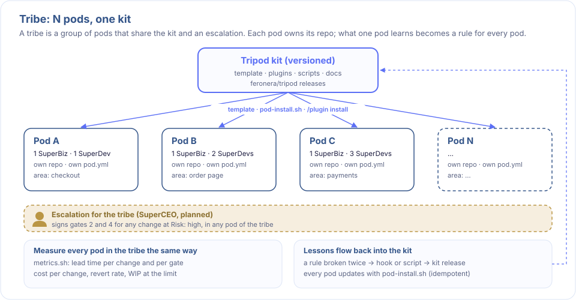

# Growing the pod

A pod starts with one SuperBiz and one SuperDev. It grows by giving a role more than one person. Pods that share the kit and an escalation form a **tribe**. Pods with several SuperDevs are covered by tests but not yet run with real teams.



## More than one person per role

Every role key in `pod.yml` accepts a comma-separated list, aligned by position. A single value works as before.

```yaml
superdev_name: Dan, Eve
superdev_email: dan@pod.example, eve@pod.example
superdev_github: dan-gh, eve-gh
```

- Any member of a role acts for that role, as owner or cross.
- One person holds one role. `gate-check --all` (and so CI) fails when an email or login appears in two roles, or a role's lists differ in length. A `_github` list may be left out. The one exception is bootstrap, below.
- `.github/CODEOWNERS` lists every SuperDev and escalation login for each risk path. Run `scripts/sync-codeowners.sh` after changing `pod.yml`.



## Starting with fewer people than roles (bootstrap)

A pod needs three seats (SuperBiz, SuperDev, escalation) but may start with two people. `bootstrap: on` covers that period:
- Escalation may share a person with one other role. SuperBiz and SuperDev must still be different people.
- When that person signs a gate that needs escalation (gates 2 and 4 at Risk: high), `scripts/gate.sh` records the escalation signature in the same step, marked `note=bootstrap`.
- In CI, one GitHub approval from that person counts for both roles, and `pr-check` prints a note saying so.
- `gate-check --all` warns while bootstrap is on, naming the person with two seats, and also if nobody holds two.
- It is a starting state. Turn it off when a third person joins.

## Peer review at gate 4

With two or more SuperDevs, the writer of the code does not approve it:
- The SuperDev who signs gate 4 as owner must not have authored any code commit in the change: a commit between the merge base with `origin/<base_branch>` (or `<base_branch>`, default `main`) and HEAD that touches a file outside `docs/`.
- `scripts/gate.sh` refuses the signature and names the code authors and who may sign instead. With no merge base or no code commit (for example after merge), the rule is skipped with a note.
- `scripts/pr-check.sh` checks the same rule on GitHub approvals ([merge-by-risk.md](merge-by-risk.md)).
- If every SuperDev wrote code, it falls back to the two-person rule: SuperBiz's cross-check is the second pair of eyes. Keep one SuperDev as the reviewer when you can.
- With one SuperDev the rule does not apply. Low-risk auto-merge relies on the agent reviewers, the second-model opinion and CI.

## SuperBiz is the bottleneck

SuperBiz owns or cross-checks every gate, so adding SuperDevs alone moves the queue to SuperBiz. Keep to 3 SuperDevs per SuperBiz; above that, `gate-check --all` warns. Add a second SuperBiz before a fourth SuperDev.

`wip_limit` stays pod-wide. Start with 2 per SuperDev, capped by what SuperBiz can review at once. If changes often wait at gate 3 or 4 for SuperBiz, lower it.

## Parallel parts across SuperDevs

A part in `## Parallel parts` of plan.md may name an `owner:` (a SuperDev email). Gate 3 checks the owner is a SuperDev, and `scripts/parallel-check.sh` prints it next to each part's result. Each SuperDev builds in their own clone or worktree; merge in the order `parallel-check --run` reports ([parallel-agents.md](parallel-agents.md)).

## When to split into two pods



Split when SuperBiz cross-checks regularly wait more than a day, WIP is always at the limit while changes wait at gates rather than in the build, or the work covers unrelated product areas. Tripod reads one `pod.yml` per repository, so each pod has its own repository, members, WIP limit and `docs/changes/`.

## Escalation and SuperCEO across a tribe

`escalation` can be a list, so a high-risk approval can come from any of several leads. To share escalation across a tribe, list the same people in each pod's `pod.yml`. The SuperCEO agent ([autonomous.md](autonomous.md#superceo)) ranks the work and writes briefs for them; people still sign.
